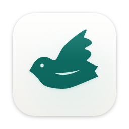
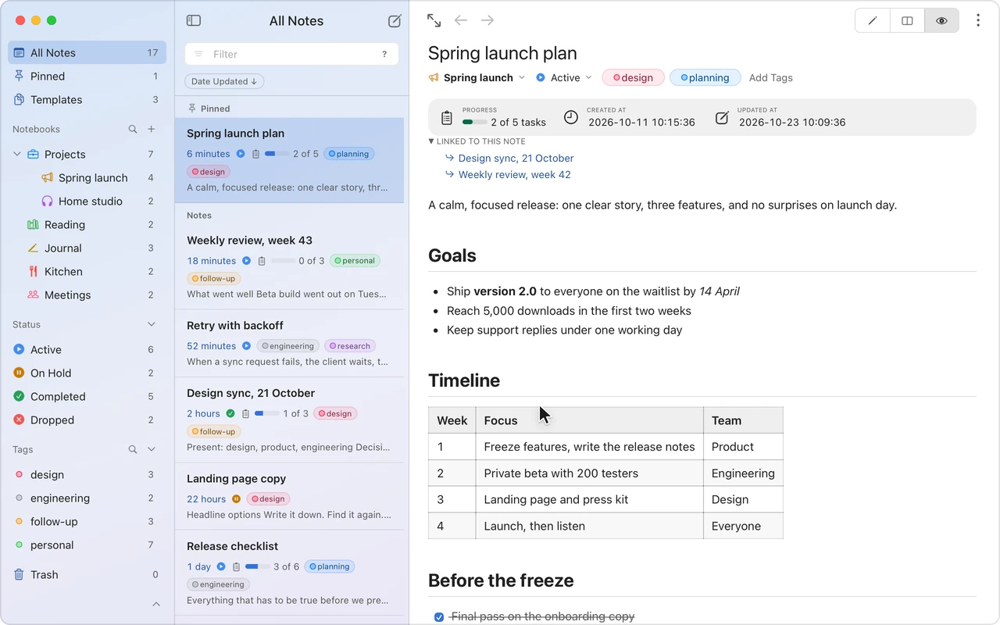
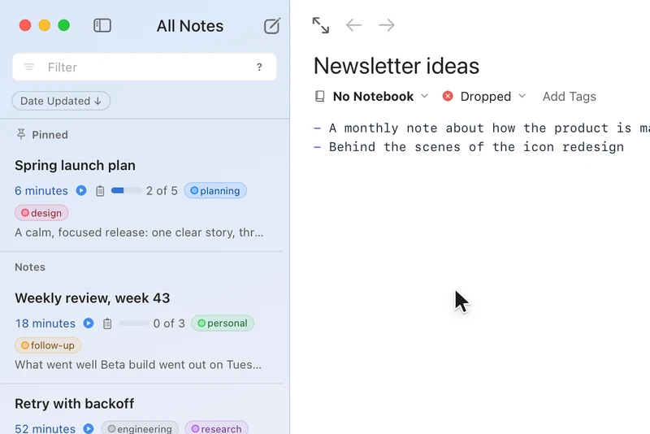
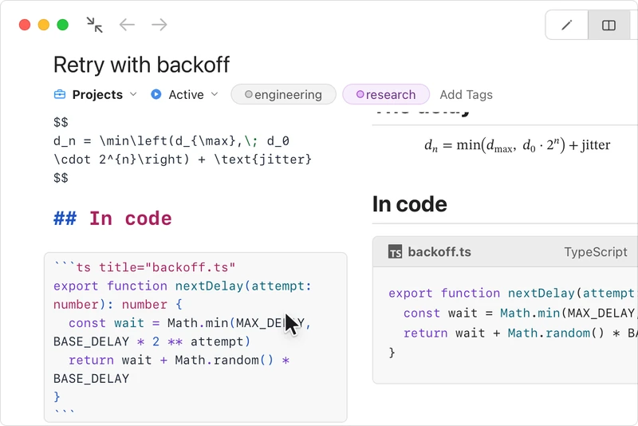
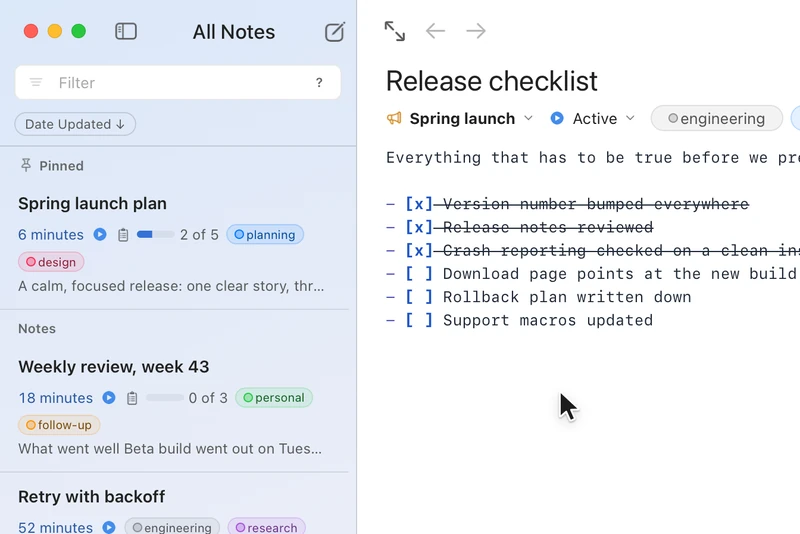
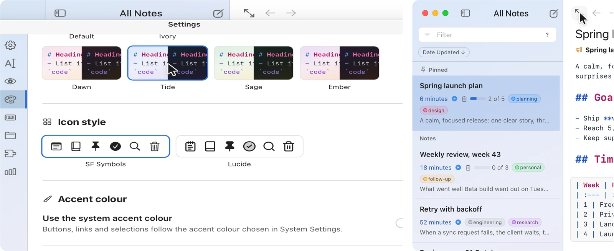
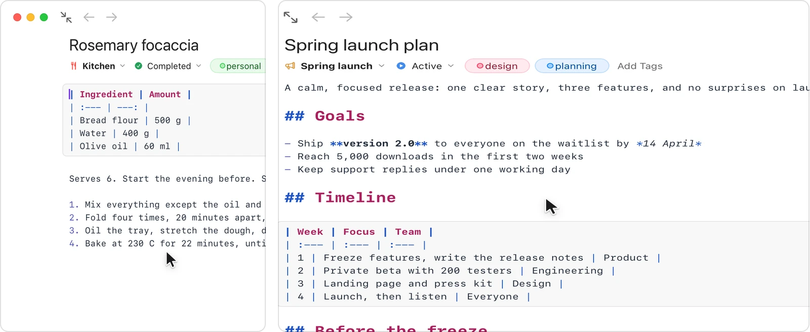
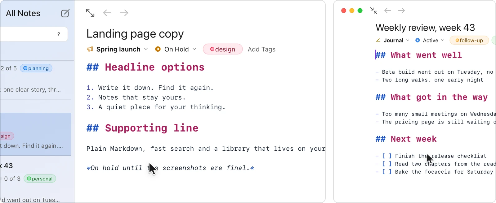

<div align="center">



# Devot

**Local-first Markdown notes for macOS. Your notes stay on your Mac, in your hands.**

[](https://github.com/jma49/devot/releases)
[](LICENSE)
[](#download)
[](https://github.com/jma49/devot/actions/workflows/ci.yml)

[Website](https://devot.online) · [Download](#download) · [Features](#features) · [devot-mcp](#claude-and-other-mcp-clients-devot-mcp) · [Development](docs/development.md)

</div>

<p align="center">
  <picture>
    <source media="(prefers-color-scheme: dark)" srcset="docs/images/hero-dark.webp">
    
  </picture>
</p>

Devot keeps your notes in a SQLite database on your Mac. Every feature works without an account or a network connection, and nothing leaves the Mac unless you export it, mirror it, let an MCP client read it, use an AI feature with your own provider key, or sync through your own relay.

**Status:** phase 1, the macOS MVP, is complete, and stable releases are available. The v1.0.5 betas add sync through your own relay, AI edit proposals and next edit suggestions with your own provider key, and licences with a three-day trial; the iOS app comes in phase 3 ([milestones](https://github.com/jma49/devot/milestones), `docs/architecture.md`, Phases).

## Download

1. Download the latest `Devot_<version>_aarch64.dmg` from the [latest release](https://github.com/jma49/devot/releases/latest) (the one marked Latest).
2. Open the dmg and drag Devot to Applications.
3. For releases up to 1.0.4, the first time, right-click Devot in Applications and choose Open, then Open again: those builds are ad-hoc signed and not notarised, so macOS asks once. Releases from 1.0.5-beta2 on are signed with Devot's Developer ID and notarised by Apple, so they open without a warning. If it only offers Move to Trash, open System Settings > Privacy & Security and click Open Anyway.

Devot needs macOS 26 or later on Apple Silicon. Updates arrive in the app: Devot checks shortly after launch and then daily (hourly on a beta build), or on Devot > Check for Updates…, downloads the update in the background and offers Restart to Update.

## Features

**Organise**

<p align="center">
  <picture>
    <source media="(prefers-color-scheme: dark)" srcset="docs/images/organise-dark.webp">
    
  </picture>
</p>

- Nestable notebooks with icons, tags with colours, note statuses (none, active, on hold, completed, dropped), pinning and a Trash.
- Open a notebook as a workspace to see only its notes and sub-notebooks.
- Templates with front matter for the title, notebook, tags and status, and placeholders such as `{{date}}`.
- Sort and filter the note list; select several notes to move, tag, export or trash them together.

**Write**

<p align="center">
  <picture>
    <source media="(prefers-color-scheme: dark)" srcset="docs/images/write-dark.webp">
    
  </picture>
</p>

- A Markdown editor with editor-only, split and preview modes, synced scrolling and a Focus Mode.
- A safe live preview with GitHub-flavoured Markdown, syntax-highlighted code blocks, math, Mermaid diagrams, emoji, alerts, task lists and YouTube and Vimeo embeds that load only when you ask.
- Tables you edit with keys: move between cells, add, move and align rows and columns, format the table.
- Pasted and dropped images and other attachments, with sizes and an image viewer.
- Find and Replace with case and regular expressions, multiple cursors, line commands and slash commands.
- Revision History: Devot keeps a version when you pause typing, and you can restore any of them.

**Find and connect**

<p align="center">
  <picture>
    <source media="(prefers-color-scheme: dark)" srcset="docs/images/find-dark.webp">
    
  </picture>
</p>

- Full-text search with a query syntax (notebook, tag, status, pinned, title or body, and exclusions).
- `[[` note links with a link index; each note lists the notes that link to it.
- `devot://` links open a note from other apps.
- A command palette for every command, and keyboard shortcuts you can change.

**Look**

- Light and dark appearance, or match the system, with a theme for each.
- Themes: Default, Ivory and four gradients (Dawn, Tide, Sage, Ember), and an option to use the system accent color.
- App, note and code fonts chosen separately, from the built-in fonts, any installed font or a font file you import (TTF, OTF, WOFF or WOFF2).
- A Glass window, as see-through as you like, or a Classic opaque one.
- macOS text services in the editor: Look Up and Speech.

**Bring notes in and out**

- Import Markdown files, a Markdown folder (with its images) or HTML files into a notebook.
- Export a note, a selection, a notebook or all notes as Markdown or HTML; export a note as PDF; print.
- Keep a Markdown mirror folder up to date with every note (below).

**Stay safe**

- Automatic daily local backups with restore (Devot > Backups…).
- Local logs and errors carry codes and IDs, never note content.
- A local activity heatmap shows when you write; usage events stay on this Mac, and Settings > Usage shows every one.

**Work with AI, on your terms**

- devot-mcp lets Claude and other MCP clients search, read, create, edit and trash notes, only in notebooks you allow (below).

<p align="center">
  <picture>
    <source media="(prefers-color-scheme: dark)" srcset="docs/images/cards-1-dark.webp">
    
  </picture>
  <br><sub>Themes · Focus Mode</sub>
</p>

<p align="center">
  <picture>
    <source media="(prefers-color-scheme: dark)" srcset="docs/images/cards-2-dark.webp">
    
  </picture>
  <br><sub>Tables you edit with Tab · Command palette</sub>
</p>

<p align="center">
  <picture>
    <source media="(prefers-color-scheme: dark)" srcset="docs/images/cards-3-dark.webp">
    
  </picture>
  <br><sub>Revision History · Templates</sub>
</p>

## Markdown mirror

Settings > Mirror (or Choose Markdown Mirror Folder… in the command palette) keeps a folder you pick up to date with every note as a Markdown file, laid out like an export: a folder per notebook, a file per note, images in an `attachments` folder. Editors, `grep`, Git, Spotlight and agents can then read your notes without an export, and importing the folder gives the same notes back. Templates and the Trash are left out; Include Attachments (on by default) decides whether images are copied.

The folder is written by Devot and never read back: edit notes in Devot.

- A mirrored file you change elsewhere is never overwritten: Devot renames it to `<name> (edited outside Devot).md`, tells you, and writes its own version. Files Devot did not write are never changed.
- If the folder goes missing (an unplugged drive) or cannot be written, the mirror pauses and resumes by itself once it can.
- If the list of files Devot wrote there (`.devot-mirror.json`) goes missing or is damaged, the mirror pauses until you choose the folder again (or put the file back); files that still hold what Devot wrote are then taken back, so nothing is written twice.

## Claude and other MCP clients (devot-mcp)

devot-mcp lets Claude Code, Codex, Claude Desktop and other MCP clients work with your notes. It is a small Node program that clients start over stdio. It reads and writes Devot's database directly, so it works whether Devot is open or not; its changes appear in an open Devot within a second, merged into a note you are editing without moving the caret or touching your undo history.

**Only notebooks with Allow AI Access on are visible.** Right-click a notebook in the sidebar and choose Allow AI Access; a sparkle marks the notebooks that have it. The switch is per notebook: a sub-notebook needs its own. Notes in the Trash and notes in no notebook are never visible.

Settings > Integrations says how many notebooks allow it and, when none does, offers to turn it on. The picker there (also in the Command Palette as **AI Access for Several Notebooks…**) switches several notebooks at once, with Undo.

| Tool              | What it does                                                    |
| ----------------- | --------------------------------------------------------------- |
| `list_notebooks`  | The notebooks it can see                                        |
| `search_notes`    | Full-text search, with snippets                                 |
| `read_note`       | A note's Markdown and metadata                                  |
| `list_tags`       | The tags                                                        |
| `create_note`     | A note in an allowed notebook, by ID or exact name              |
| `update_note`     | Title, the whole body or exact passages, notebook, tags, status |
| `trash_note`      | Moves a note to the Trash                                       |
| `create_notebook` | A notebook with Allow AI Access on                              |

Edits apply directly. Before each one, Devot keeps the note's text as it was in its Revision History (the note's menu), so you can restore it.

### Set it up

devot-mcp runs from a checkout of this repository (requirements in `docs/development.md`). Build it once, and again after pulling changes:

```sh
pnpm install
pnpm mcp:build        # writes dist-mcp/devot-mcp.mjs
```

Run Devot once first, so the database exists and is up to date; devot-mcp never creates or upgrades the database. It reads the release app's `~/Library/Application Support/io.github.jma49.devot/devot.sqlite`; pass `--db <path>` to use another file, such as a debug build's in `io.github.jma49.devot.dev`.

Settings > Integrations in Devot shows these configs ready to copy, with the checkout's path filled in when the app was built from it.

**Claude Code** (run from the repository root; `claude mcp list` shows whether it connected):

```sh
claude mcp add --scope user devot -- node "$PWD/dist-mcp/devot-mcp.mjs"
```

**Codex:** add this to `~/.codex/config.toml`:

```toml
[mcp_servers.devot]
command = "node"
args = ["/absolute/path/to/devot/dist-mcp/devot-mcp.mjs"]
```

**Claude Desktop:** add this to `~/Library/Application Support/Claude/claude_desktop_config.json` (Settings > Developer > Edit Config), with absolute paths, then restart Claude Desktop:

```json
{
  "mcpServers": {
    "devot": {
      "command": "/absolute/path/to/node",
      "args": ["/absolute/path/to/devot/dist-mcp/devot-mcp.mjs"]
    }
  }
}
```

Use the Node that ran `pnpm install` (`which node` prints its path): better-sqlite3 is a native module built for that version. devot-mcp writes its logs (codes and IDs only, never note text) to stderr; errors returned to the client start with a code such as `E_STORAGE_SCHEMA_TOO_OLD`.

## Crash reports

Crash reports are off unless a build is made with a Sentry DSN. Release builds may carry one; a build from a fresh clone has none, sends nothing and starts no crash reporter. Reports carry codes and IDs, never note content. Setting it up for your own builds: `docs/development.md`, Crash reporting in local builds.

## Development

Requirements, scripts, the source layout and the test tools are in [`docs/development.md`](docs/development.md). In short:

```sh
pnpm install
pnpm dev      # run the app with hot reload
pnpm check    # everything CI runs
```

How releases are made: [`docs/releasing.md`](docs/releasing.md). Architecture and decisions: [`docs/architecture.md`](docs/architecture.md).

## Contributing

Fork the repository, work on a branch and open a pull request with a Conventional Commits title (`feat:`, `fix:`, `test:`, `docs:`, `refactor:`, `chore:`). CI must pass before a pull request is merged; `pnpm check` runs the same checks locally. Changes reach `main` only through pull requests, and the `pre-push` hook blocks direct pushes. The rules every change follows are in [`CLAUDE.md`](CLAUDE.md).

## Security

Report security problems privately, as [`SECURITY.md`](SECURITY.md) describes.

## License

[FSL-1.1-MIT](LICENSE): use, change and share Devot for anything but a competing commercial product. Each release becomes MIT two years after it is published. Versions up to v1.0.4 were published under MIT and stay MIT.

Devot works fully for a three-day trial; after it, notes are read-only (you can read, search, copy and export them) and sync and AI are locked until you add a license bought once, which unlocks them on all your devices in every version ([ADR 0006](docs/adr/0006-source-available-and-sold-once.md)).
