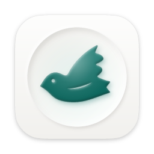
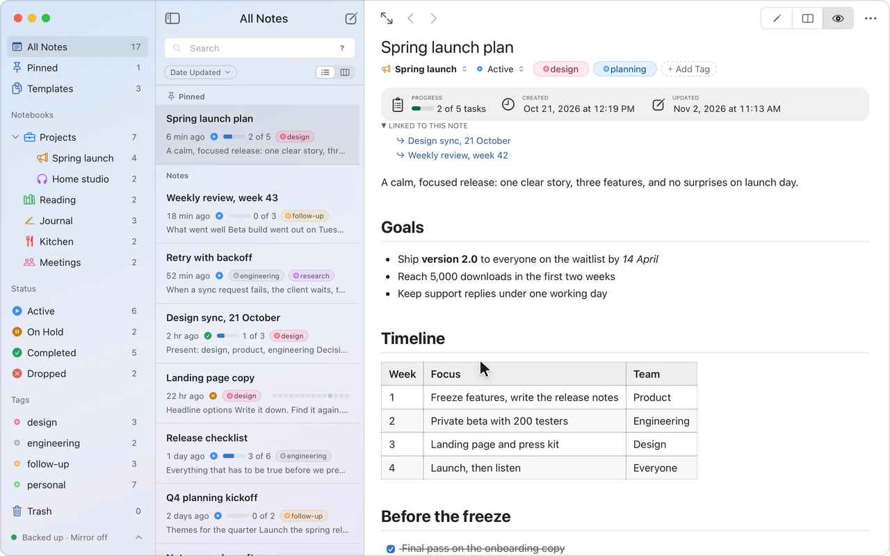
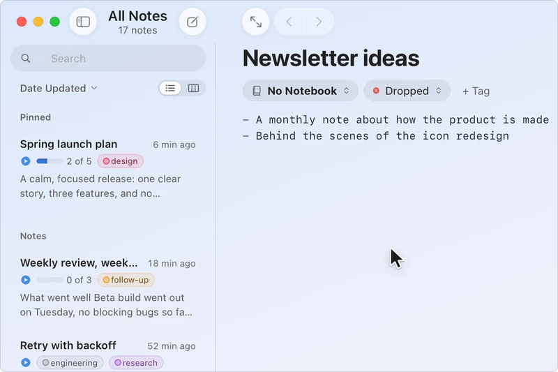
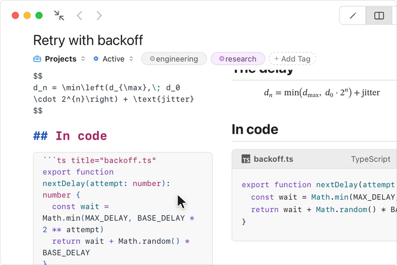
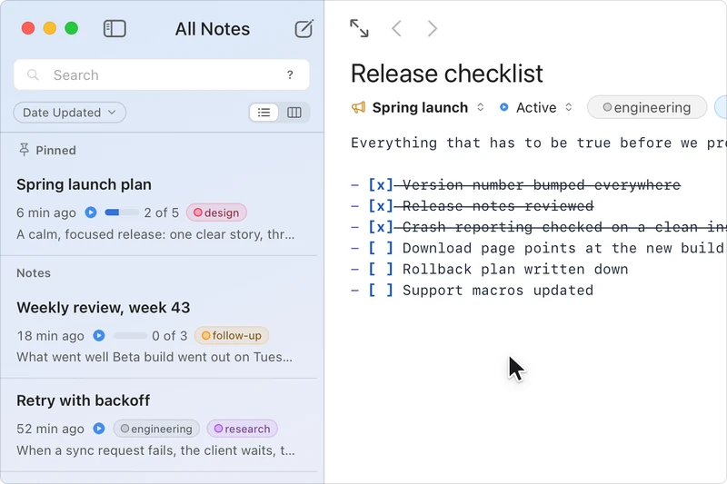
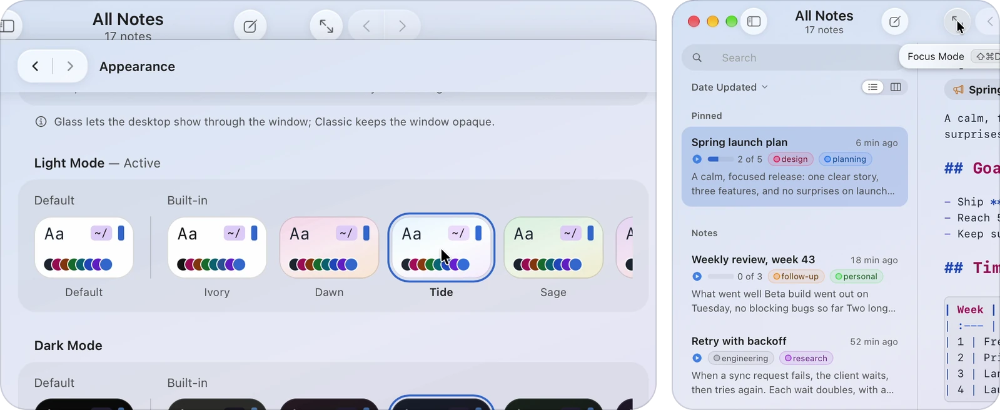
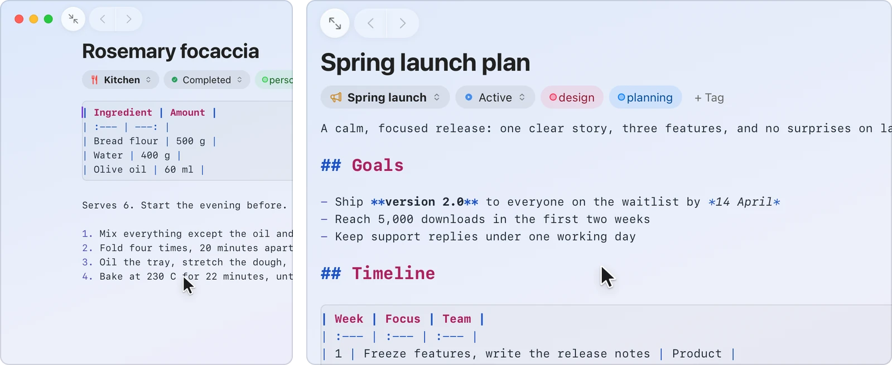
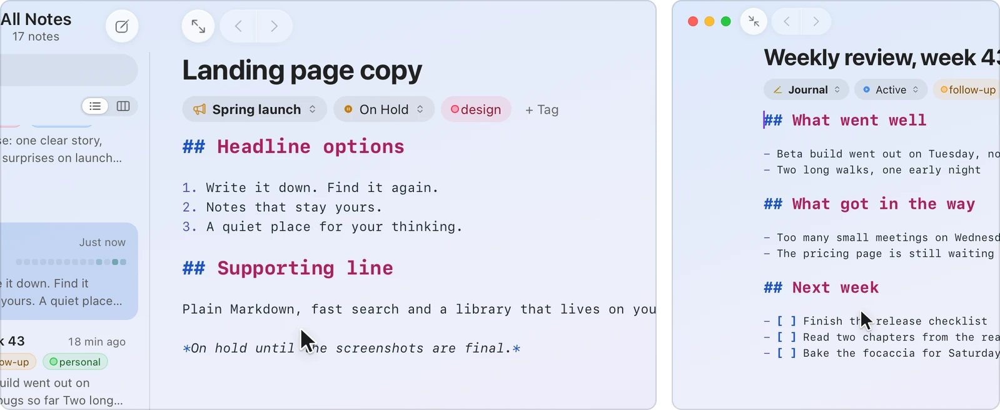

<div align="center">



# Devot

**Local-first Markdown notes for Mac and iPhone. Your notes stay on your devices, in your hands.**

[](https://github.com/jma49/devot/releases)
[](LICENSE)
[](#download)
[](https://devot.online)
[](https://github.com/jma49/devot/actions/workflows/ci.yml)

[Website](https://devot.online) · [Docs](https://devot.online/docs) · [Download](#download) · [Features](#features) · [Plugins](#plugins-on-mac) · [AI tools](#claude-and-other-mcp-clients) · [Development](docs/development.md)

</div>

<p align="center">
  <picture>
    <source media="(prefers-color-scheme: dark)" srcset="docs/images/hero-dark.webp">
    
  </picture>
</p>

Local-first Markdown notes for Mac and iPhone: live preview, end-to-end encrypted sync, plugins, themes and MCP for AI tools.

Devot keeps your notes in a SQLite database on your Mac or iPhone.
Writing, organising and searching work offline without a Devot account.
You choose whether to sync your notes, share a page on the web or use an AI provider.
The product site is [devot.online](https://devot.online).
The iOS app is on the App Store and also runs on iPad.
The Mac app is a signed, notarised download for macOS 15 or later, on Apple Silicon and Intel.

## Download

**Mac:** Download `Devot_<version>_universal.dmg` from the [latest release](https://github.com/jma49/devot/releases/latest), open it and drag Devot to Applications.
Current builds are signed and notarised, and require macOS 15 or later on Apple Silicon or Intel.
Devot checks for updates automatically; use **Devot > Check for Updates…** to check now.

**iPhone and iPad:** Devot is on the App Store. The iPad runs the same screens, in columns when the window is wide.

## Features

This list follows the current source; see the [release notes](https://github.com/jma49/devot/releases) for what's in the downloadable builds.

**Organise**

<p align="center">
  <picture>
    <source media="(prefers-color-scheme: dark)" srcset="docs/images/organise-dark.webp">
    
  </picture>
</p>

- Nestable notebooks with icons, tags with colours, note statuses (none, active, on hold, completed, dropped), pinning and a Trash.
- Open a notebook as a workspace to see only its notes and sub-notebooks.
- Templates with front matter for the title, notebook, tags and status, and placeholders such as `{{date}}`.
- Today's note, made from a daily template you choose, and a Quick Note from the menu bar.
- See a notebook as a list, as a gallery of page previews, or as a board by status with each card's task progress.
- Sort and filter the note list; select several notes to move, tag, export or trash them together.

**Write**

<p align="center">
  <picture>
    <source media="(prefers-color-scheme: dark)" srcset="docs/images/write-dark.webp">
    
  </picture>
</p>

- A Markdown editor with editor-only, split and preview modes, synced scrolling and a Focus Mode.
- Write mode: the note renders as you write and shows the Markdown only of the element under the caret.
- A resizable note inspector with Outline, Info and History, and word and character counts in the editor.
- A safe live preview with GitHub-flavoured Markdown, syntax-highlighted code blocks, math, Mermaid and PlantUML diagrams, Markmap mind maps, emoji, alerts, task lists and YouTube and Vimeo embeds that load only when you ask.
- Tables you edit with keys: move between cells, add, move and align rows and columns, format the table.
- Pasted and dropped images and other attachments, with sizes and an image viewer.
- Find and Replace with case and regular expressions, multiple cursors, line commands and slash commands.
- Optional Vim keybindings in **Settings > Editing > Vim Mode**.
- Revision History: Devot keeps a version when you pause typing, and you can restore any of them.

**Find and connect**

<p align="center">
  <picture>
    <source media="(prefers-color-scheme: dark)" srcset="docs/images/find-dark.webp">
    
  </picture>
</p>

- Full-text search with a query syntax (notebook, tag, status, pinned, title or body, and exclusions), and saved searches in the sidebar.
- **Related by Meaning** adds semantic matches below keyword results, even when the words differ.
  It uses the system's on-device sentence model where available, without an AI provider or internet connection.
- **Image text search (OCR)** finds notes by words in attached screenshots, receipts and photos on Mac and iPhone.
  Recognition runs on the device and doesn't change the note or sync the extracted text.
- Connect notes with `[[` links, see backlinks and unlinked mentions, embed notes and explore their connections in Graph view.
- `devot://` links open a note from other apps.
- The browser clipper saves articles or selections with images; capture links fill Quick Capture from Shortcuts or a launcher (below).
- A command palette that finds commands and searches note titles and bodies, and keyboard shortcuts you can change.

**Look**

- Light and dark appearance, or match the system, with a theme for each.
- Themes: Default, Ivory and four gradients (Dawn, Tide, Sage, Ember), and an option to use the system accent color.
- App, note and code fonts chosen separately, from the built-in fonts, any installed font or a font file you import (TTF, OTF, WOFF or WOFF2).
- A Glass window, as see-through as you like.
- macOS text services in the editor: Look Up and Speech.
- English and Simplified Chinese on Mac and iPhone.
  Follow the system language or choose one under **Settings > General > App Language**; the change takes effect the next time Devot opens.

**Bring notes in and out**

- Import Markdown files, a Markdown folder (with its images), HTML files, a Notion Markdown export or Bear TextBundles into a notebook; links between the imported files become note links.
- Import an Obsidian vault on Mac, bringing across note properties and converting Canvas files into notes.
- Export a note, a selection, a notebook or all notes as Markdown or HTML; export a note as PDF; print.
- **Share on Web** publishes an encrypted, read-only page with an expiry date; anyone with the link can read it.
- Keep a Markdown mirror folder up to date with every note (below).

**Sync, on your terms**

- End-to-end encrypted sync between your Mac and iPhone through your own iCloud, or through a relay you deploy ([docs/sync-relay.md](docs/sync-relay.md)): each note is sealed on the device before it leaves.
- Devices on your Apple ID receive the key through iCloud Keychain; a pairing code works everywhere else.
- Sync needs no Devot account and doesn't store your notes on a Devot server.

**Stay safe**

- Automatic daily local backups with restore (Devot > Backups…).
- Local logs and errors carry codes and IDs, never note content.
- A local activity heatmap shows when you write; usage events stay on this Mac, and Settings > Usage shows every one.

**Work with AI, on your terms**

- Claude and other MCP clients can search, read, create, edit and trash notes, only in notebooks you allow (below).
- **Edit with AI** improves, proofreads, summarises or restructures a selection, with a diff you can review before accepting it.
- **Ask Your Notes** streams answers with links back to the source notes, using only notebooks you've allowed AI to access.
- Choose Anthropic or an OpenAI-compatible endpoint, including a local model server.
  On Mac, you can also use an installed and signed-in Claude Code or Codex CLI as the provider.
- **Review Changes** lets you keep or undo individual edits made by an agent.
- Suggest Next Edit offers a continuation at the caret as ghost text; Tab accepts it.

<p align="center">
  <picture>
    <source media="(prefers-color-scheme: dark)" srcset="docs/images/cards-1-dark.webp">
    
  </picture>
  <br><sub>Themes · Focus Mode</sub>
</p>

<p align="center">
  <picture>
    <source media="(prefers-color-scheme: dark)" srcset="docs/images/cards-2-dark.webp">
    
  </picture>
  <br><sub>Tables you edit with Tab · Command palette</sub>
</p>

<p align="center">
  <picture>
    <source media="(prefers-color-scheme: dark)" srcset="docs/images/cards-3-dark.webp">
    
  </picture>
  <br><sub>Revision History · Templates</sub>
</p>

## Plugins on Mac

Open **Settings > Plugins > Official Plugins** to browse, install and update official plugins, or install a plugin from a local folder or ZIP archive.
Devot shows what a plugin can access before you approve it, and runs plugins in a sandbox.
Plugins can add themes, commands, preview renderers and import or export formats.
iPhone doesn't run plugins, but it can display saved plugin drawings synced from a Mac.

To build a plugin, use the [plugin kit](plugin-kit/README.md) to scaffold, validate and package it.

## Capture from anywhere

Use your system's Share menu to send content to Devot on Mac or iPhone.
On iPhone, use the **Add to Devot** and **Open Today's Note** Shortcuts actions, or open today's note from a widget or Control Center.

`devot://capture?title=…&text=…&url=…` opens Quick Capture with the text filled in; you save it with ⌘↩ or cancel, so a link never makes a note by itself.
Every field is optional and percent-encoded, and `url` must be an http or https address.

- **Shortcuts:** an Open URLs action with `devot://capture?text=` followed by the Shortcut Input, URL-encoded.
- **Launchers:** open a capture link with URL-encoded title, text and source URL.
- **Browser clipper:** run `pnpm install` and `pnpm clipper:build`.
  In Chrome, enable Developer mode at `chrome://extensions` and Load unpacked **clipper/dist/chrome**.
  In Firefox, open `about:debugging#/runtime/this-firefox`, choose Load Temporary Add-on and select **clipper/dist/firefox/manifest.json** (temporary installs last until Firefox closes; persistent installs require signing).
  The clipper's settings open on install and walk through connecting it: turn on Devot's local HTTP API with Read and Write access, paste the token, add the extension's origin under Browser Extensions, and allow AI access on a notebook; Save and Check confirms each step.
  On any page, click the Devot button, check the title and notebook, choose Article or Selection and press Enter; Open in Devot shows the new note.
  Allow Image Downloads in the clipper's settings to save images into the note; images that cannot be downloaded stay web links.
  The token is stored locally in the browser profile, not synced.

## Markdown mirror

Settings > Mirror (or Choose Markdown Mirror Folder… in the command palette) keeps a folder you pick up to date with every note as a Markdown file, laid out like an export: a folder per notebook, a file per note, images in an `attachments` folder. Editors, `grep`, Git, Spotlight and agents can then read your notes without an export, and importing the folder gives the same notes back. Templates and the Trash are left out; Include Attachments (on by default) decides whether images are copied.

Turn on Bring Back Outside Edits to edit the files in other apps too: a file you change elsewhere goes back into its note (title, tags and status from its front matter, images still linked), merged into the note as an edit, so the note's history and sync keep working.

- A mirrored file you change elsewhere is never overwritten: without Bring Back Outside Edits, or when the note changed in Devot as well, Devot renames the file to `<name> (edited outside Devot).md`, tells you, and writes its own version. Files Devot did not write are never changed.
- If the folder goes missing (an unplugged drive) or cannot be written, the mirror pauses and resumes by itself once it can.
- If the list of files Devot wrote there (`.devot-mirror.json`) goes missing or is damaged, the mirror pauses until you choose the folder again (or put the file back); files that still hold what Devot wrote are then taken back, so nothing is written twice.

## Claude and other MCP clients

Claude Code, Codex, Claude Desktop and other MCP clients can work with your notes through Devot. Nothing else needs to be installed: clients run a small bridge inside Devot's own binary, which talks to the running app on this Mac only. Changes appear within a moment, merged into a note you are editing without moving the caret or touching your undo history. The [AI tools guide](https://devot.online/docs/ai-tools) has the same setup step by step.

**Only notebooks with Allow AI Access on are visible.** Right-click a notebook in the sidebar and choose Allow AI Access; a sparkle marks the notebooks that have it. The switch is per notebook: a sub-notebook needs its own. Notes in the Trash and notes in no notebook are never visible.

Settings > Integrations > AI Tools says how many notebooks allow it, with **Choose…** to change that, and when none does it offers to turn it on. The picker there (also in the Command Palette as **AI Access for Several Notebooks…**) switches several notebooks at once, with Undo.

| Tool              | What it does                                                          |
| ----------------- | --------------------------------------------------------------------- |
| `list_notebooks`  | The notebooks it can see                                              |
| `search_notes`    | Full-text search, with snippets                                       |
| `read_note`       | A note's Markdown and metadata                                        |
| `list_tags`       | The tags                                                              |
| `create_note`     | A note in an allowed notebook, by ID or exact name                    |
| `update_note`     | Title, the whole body or exact passages, notebook, tags, status       |
| `append_to_note`  | Text at the end or start of a section under a heading, or of the note |
| `trash_note`      | Moves a note to the Trash                                             |
| `create_notebook` | A notebook with Allow AI Access on                                    |

Edits apply directly. Before each one, Devot keeps the note's text as it was in its Revision History (the note's menu), so you can restore it.

### Set it up

Open **Settings > Integrations** and choose **Connect** for Claude Code, Codex or Claude Desktop. It shows the file and the exact text first, keeps everything else in the file, and keeps a backup beside it. The token stays in your keychain and never goes in that file. Restart the client afterwards. Install Devot in Applications first: Connect waits while it runs from a disk image.

**Set Up by Hand**, at the end of the Clients card, has the configuration to copy, for these clients and any other. On a default install:

```sh
claude mcp add --scope user devot -- /Applications/Devot.app/Contents/MacOS/devot --cli mcp
```

```toml
# ~/.codex/config.toml
[mcp_servers.devot]
command = "/Applications/Devot.app/Contents/MacOS/devot"
args = ["--cli", "mcp"]
```

### Devot may start in the background

AI tools need Devot running. When a tool asks and Devot is closed, Devot starts in the background with no window and no Dock icon, and shows an icon in the menu bar with **Quit Devot**. It quits by itself after 10 minutes without a request, unless you opened a window, and it saves first as any quit does. After you quit it, the next request starts it again.

The Status row in Settings > Integrations > AI Tools shows whether it is running that way, and then has its own **Quit Devot**. Turn **Start in the Background** off and tools get a clear error until you open Devot yourself. **Allow AI Tools** there stops them altogether, and **Access** chooses Read Only or Read and Write. None of this turns on the Local HTTP API, which has its own switch and token.

Errors returned to a client start with a code such as `E_MCP_BACKGROUND_START_OFF`. Logs hold codes and IDs, never note text.

## Crash reports

Crash reports are off until you turn them on in Settings > General, and turning them off deletes any not yet sent. They carry error codes and code locations, never note text. A build from a fresh clone has no Sentry DSN, sends nothing and starts no crash reporter. Setting it up for your own builds: `docs/development.md`, Crash reporting in local builds.

## Development

Requirements, scripts, the source layout and the test tools are in [`docs/development.md`](docs/development.md). In short:

```sh
pnpm install
pnpm dev      # run the app with hot reload
pnpm check    # everything CI runs
```

How releases are made: [`docs/releasing.md`](docs/releasing.md). Architecture and decisions: [`docs/architecture.md`](docs/architecture.md), an overview that links a spec for each area in [`docs/specs/`](docs/specs/).
How this repository describes Devot for search, directories and answer engines: [`llms.txt`](llms.txt) and [`seo/README.md`](seo/README.md).

## Contributing

Fork the repository, work on a branch and open a pull request with a Conventional Commits title (`feat:`, `fix:`, `test:`, `docs:`, `refactor:`, `chore:`). CI must pass before a pull request is merged; `pnpm check` runs the same checks locally. Changes reach `main` only through pull requests, and the `pre-push` hook blocks direct pushes. The rules every change follows are in [`CLAUDE.md`](CLAUDE.md).

## Security

Report security problems privately, as [`SECURITY.md`](SECURITY.md) describes.

## License

[FSL-1.1-MIT](LICENSE): use, change and share Devot for anything but a competing commercial product. Each release becomes MIT two years after it is published. Versions up to v1.0.4 were published under MIT and stay MIT.

Devot works fully for a 30-day trial.
After the trial, you can still read, search by keyword, copy and export your notes; editing, sync, semantic search and AI require a license.
A one-time purchase unlocks them on up to three devices at a time in every version ([ADR 0006](docs/adr/0006-source-available-and-sold-once.md)).

The source is public, so paying is optional: a build you make yourself ([docs/development.md](docs/development.md)) checks no license, and everything in it works. You can use and change it for free, as long as you do not sell it or offer it as a competing product, and it does not carry Devot's name or icon when you share it. It has no signed installer or automatic updates. The license pays for those, and for the work on Devot.
