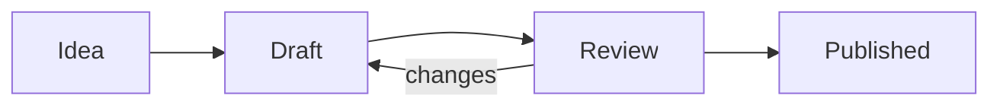

Everything below is plain Markdown. Open this note in the editor (View menu, _Show Editor and Preview_) to see how each piece is written. The block above, between the two `---` lines, is _front matter_: Devot shows it in a box at the top of the preview.

## Headings

# Heading 1

## Heading 2

### Heading 3

#### Heading 4

##### Heading 5

###### Heading 6

## Text

Plain text can be **bold**, _italic_, _**both**_, ~~struck through~~ or <mark>highlighted</mark>. Use `inline code` for short snippets, and keys look like <kbd>{{key:note.new}}</kbd> when you wrap them in `kbd`. Superscripts such as x<sup>2</sup> and subscripts like H<sub>2</sub>O work too, and so do emoji shortcodes: :tada: :sparkles:

A line that ends with two spaces  
continues on the next line.

---

## Lists

- A bulleted list
  - nests when you indent
  - as deep as you like
- Back at the top

1. A numbered list
2. keeps counting
3. for you

Task lists show check boxes:

- [x] Read the welcome note
- [x] Open the Markdown example
- [ ] Write a first note of your own

## Quotes and alerts

> A quote can run over several lines
> and hold _other Markdown_ too.

> [!NOTE]
> Useful information that readers should know.

> [!TIP]
> A helpful suggestion.

> [!IMPORTANT]
> Something readers need to know to succeed.

> [!WARNING]
> Something that needs attention.

> [!CAUTION]
> A risk of a bad outcome.

## Links and images

A [web link](https://example.com) opens in your browser, and a link to a note stays inside Devot: back to [Welcome to Devot](devot://note/{{id:welcome}}). Type `[[` in the editor to link to any note by its title. A bare address such as https://example.com becomes a link as well.


Pictures you paste or drop are stored with the note. After the address, `#small`, `#half` or `#full` sets their size (also in the image's context menu).

## Tables

| Notebook | Notes |    Status |
| :------- | :---: | --------: |
| Work     |  12   |    Active |
| Reading  |   4   |   On Hold |
| Archive  |  30   | Completed |

While the cursor is in a table, Tab moves to the next cell, and Format Table in the command palette lines the columns up.

## Code

A fenced block takes a language, and a `title` for its heading bar:

```ts title="example.ts"
interface Note {
  title: string
  tags: string[]
}

export function describe(note: Note): string {
  return `${note.title} (${note.tags.length} tags)`
}
```

```python title="greet.py"
def greet(name: str) -> str:
    return f"Hello, {name}!"
```

```sh
pnpm install
```

A block without a language is plain text:

```
no highlighting, no title
```

## Math

Inline math sits in a sentence, like $E = mc^2$, and a display block has its own line:

$$
\int_0^1 x^2 \, dx = \frac{1}{3}
$$

## Diagrams

A `mermaid` block draws a diagram:



## Footnotes

Footnotes collect at the end of the note.[^1] They can be named anything.[^second]

[^1]: Like this one.

[^second]: Written as `[^second]` in the text.
