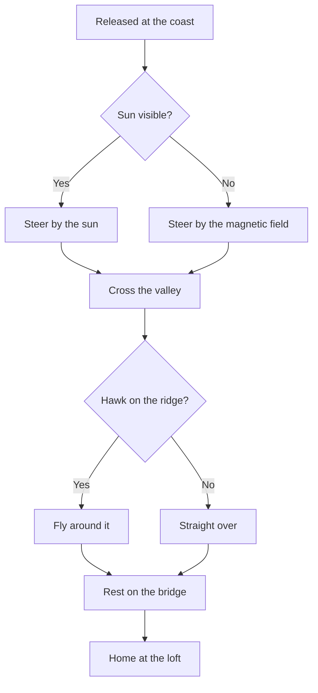
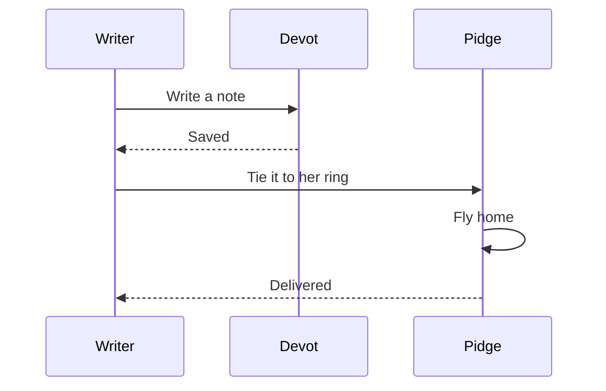
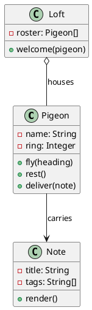

*A homing pigeon's field notes, and a tour of everything Devot can render.*

Everything below is plain Markdown. Open this note in the editor (*Show Editor* or *Show Editor and Preview*) to see how each piece is written. The block above, between the two `---` lines, is *front matter*: Devot shows it in a box at the top of the preview.

## Contents

- [Headings](#headings)
- [Text](#text)
- [Lists and tasks](#lists-and-tasks)
- [Quotes and alerts](#quotes-and-alerts)
- [Links and images](#links-and-images)
- [Tables](#tables)
- [Code](#code)
- [Math](#math)
- [Diagrams](#diagrams)
- [Footnotes](#footnotes)
- [Rules, symbols and escapes](#rules-symbols-and-escapes)

---

## Headings

Six levels, from the whole journey down to a single feather:

# Day 1: Released at the Coast

## The basket opened at dawn

### She circled the field twice

#### found the sun over her left wing

##### and the wind off the sea

###### then turned for home

---

## Text

**Pidge** was a homing pigeon, and a *very* punctual one. She carried notes, not letters: ~~long letters~~ short notes, written in Markdown, rolled up in a ring on her leg. Some words mattered more than others, so the writer marked them **bold**, *italic*, ***both at once***, or <mark>highlighted</mark> so they would not be missed.

The note on her leg read `meet at the old tower, 6pm`. To send another, the writer pressed <kbd>{{key:note.new}}</kbd>; to find an old one, <kbd>⌘</kbd> <kbd>K</kbd>.

She flew at 10<sup>3</sup> metres, through air thick with H<sub>2</sub>O, and arrived to applause: :tada: :sparkles: :bird:

A line that ends with two spaces  
continues on the next line,  
the way a pigeon keeps going after a short rest.

A blank line starts a new paragraph.

---

## Lists and tasks

### What Pidge packs for a flight

- **Navigation**
  - The sun, by day
  - The Earth's magnetic field, always
    - felt rather than seen
    - steady even under cloud
  - Landmarks: rivers, roads, the old tower
- **Supplies**
  - One rolled-up note
  - Nothing else; weight matters

### The route, in order

1. **Leave the coast**
   1. Circle to get bearings
   2. Pick the heading
2. **Cross the valley**
   - Ride the warm air over the fields
   - Skip the hawk's ridge
3. **Rest on the bridge**
4. **Arrive at the loft**

### Pidge's flight log

Task lists show check boxes:

- [x] Read the welcome note
- [x] Open the Markdown example
- [x] Leave the coast
- [ ] Reach the loft before dark
  - [x] Cross the valley
  - [x] Rest on the bridge
  - [ ] Find the window left open
- [ ] Write a first note of your own

---

## Quotes and alerts

The keeper wrote this on the loft wall:

> A pigeon does not know the map.
> She knows the way home,
> and that is *better*.

Quotes nest when you add more `>`:

> Where are you going?
>> Home.
>>> How do you know where that is?

GitHub-style alerts get a colour and an icon:

> [!NOTE]
> Homing pigeons can find their way back from hundreds of kilometres away.

> [!TIP]
> Type `[[` in the editor to link to any note by its title.

> [!IMPORTANT]
> Pictures you paste or drop are stored with the note, so the note travels with everything it needs.

> [!WARNING]
> Hawk on the ridge. Fly around it.

> [!CAUTION]
> Don't open the loft window during a storm.

---

## Links and images

A [web link](https://example.com) opens in your browser, and a link to a note stays inside Devot: back to [Welcome to Devot](devot://note/{{id:welcome}}). A bare address such as https://example.com becomes a link as well. Headings are link targets too, so you can jump back to [Text](#text).


After the address, `#small`, `#half` or `#full` sets an image's size (also in the image's context menu):


---

## Tables

### The loft roster

| Pigeon     | Role       | Favourite saying                 |
| ---------- | ---------- | -------------------------------- |
| **Pidge**  | Courier    | "Home is a direction."           |
| **Rook**   | Navigator  | "Follow the river."              |
| **Biscuit**| Lookout    | "Hawk! Hawk! Oh, it's a leaf."   |
| **Old Gus**| Keeper     | "Every note arrives eventually." |

### Delivery record

Colons in the divider row set alignment: left, centre, right.

| Route              | Distance | Days | Delivered |
| :----------------- | -------: | :--: | :-------: |
| Coast → Loft       |   120 km |  1   |    ✅     |
| Mountains → Loft   |   310 km |  2   |    ✅     |
| City → Loft        |    45 km |  1   |    ❌     |
| Island → Loft      |   480 km |  3   |    ✅     |

While the cursor is in a table, Tab moves to the next cell, and Format Table in the command palette lines the columns up.

---

## Code

A fenced block takes a language, and a `title` for its heading bar:

```ts title="flight.ts"
interface Note {
  title: string
  tags: string[]
}

type Heading = 'north' | 'south' | 'east' | 'west'

export function deliver(note: Note, heading: Heading): string {
  return `Carrying "${note.title}" ${heading} (${note.tags.length} tags)`
}
```

```python title="homing.py"
import math

def bearing_home(lat: float, lon: float, home: tuple[float, float]) -> float:
    """Compass bearing from where Pidge is to the loft, in degrees."""
    d_lon = math.radians(home[1] - lon)
    lat1, lat2 = math.radians(lat), math.radians(home[0])
    x = math.sin(d_lon) * math.cos(lat2)
    y = math.cos(lat1) * math.sin(lat2) - math.sin(lat1) * math.cos(lat2) * math.cos(d_lon)
    return (math.degrees(math.atan2(x, y)) + 360) % 360
```

```rust title="loft.rs"
fn main() {
    let roster = ["Pidge", "Rook", "Biscuit"];
    for name in roster {
        println!("{name} is home");
    }
}
```

```json title="note.json"
{
  "title": "Meet at the old tower",
  "time": "18:00",
  "urgent": true
}
```

```sh
pnpm install
```

A block without a language is plain text:

```
no highlighting, no title
just the words, the way they were written
```

Inline code fits in a sentence: Pidge's ring is tagged `ring.id = 0042`.

---

## Math

Inline math sits in a sentence, like $E = mc^2$, or Pidge's average speed $\bar{v} = \frac{d}{t}$. A display block has its own line:

$$
\bar{v} = \frac{120\ \text{km}}{2.5\ \text{h}} = 48\ \text{km/h}
$$

The great-circle distance home, by the haversine formula:

$$
d = 2r \arcsin\left(\sqrt{\sin^2\frac{\Delta\varphi}{2} + \cos\varphi_1 \cos\varphi_2 \sin^2\frac{\Delta\lambda}{2}}\right)
$$

And the odds that a note eventually arrives:

$$
P(\text{arrive}) = \lim_{n \to \infty} \left(1 - (1 - p)^n\right) = 1 \quad \text{for any } p > 0
$$

---

## Diagrams

### The flight, as a flowchart

A `mermaid` block draws a diagram:



### A note's life, as a sequence



### The loft, as UML

A `plantuml` block (or `puml`) draws UML locally:



### Everything in this note, as a mind map

A `markmap` block turns a Markdown outline into a mind map:

```markmap
# Devot Markdown
## Writing
- Headings
- Bold, italic, highlight
- Lists and tasks
- Quotes and alerts
## Linking
- Web links
- Note links
- Images with sizes
## Structure
- Tables
- Code with titles
- Footnotes
## Rendering
- Math
- Mermaid
- PlantUML
- Markmap
```

All three render offline and are included in HTML and PDF exports. Markmap shows a static, fully expanded map with plain-text labels. PlantUML uses its built-in Smetana layout; external includes and libraries are not loaded.

---

## Footnotes

Homing pigeons[^homing] have carried messages for thousands of years[^history]. They navigate with several senses at once[^senses], and a good one comes home almost every time.[^1] Footnotes collect at the end of the note, and they can be named anything.[^named]

[^homing]: Bred specifically to return to their home loft.

[^history]: Long before Markdown, and long before paper was cheap.

[^senses]: The sun, the Earth's magnetic field, landmarks, and possibly smell.

[^1]: Like this one, numbered.

[^named]: Written as `[^named]` in the text.

---

## Rules, symbols and escapes

Three ways to draw a horizontal rule:

---

***

___

Special characters come through as typed:

- En dash: Day 1–3
- Em dash: Pidge flew—without stopping—to the bridge
- Arrows: Coast → Loft ← City
- Ellipsis: almost home…
- Copyright: © The Loft

A backslash shows a Markdown character as itself: \*not italic\*, \# not a heading, \[not a link\].

---

> [!TIP]
> That's the tour. Press <kbd>{{key:note.new}}</kbd> and send your own note home. 🕊️
